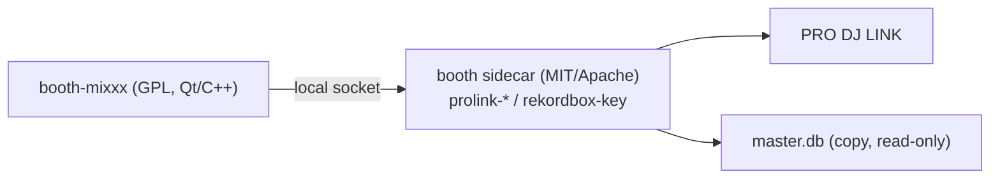

# booth-mixxx

Mixxx の個人フォーク。PRO DJ LINK（実機デッキ・rekordbox ライブラリ）を扱える DJ アプリにするための土台。
上流のコードと履歴をそのまま保ち、差分は小さく保つ。

- 上流: <https://github.com/mixxxdj/mixxx>（`upstream`、HEAD `64c1cbe`、2026-11-06 時点の `main`）
- 公開先: <https://github.com/P4sTela/booth-mixxx>（`origin`、public）
- このリポジトリのライセンス: **GPL-2.0-or-later**（上流と同じ。追加したコードも同じ）
- 元の Mixxx: Digital DJ'ing software, Copyright (C) 2001-2026 Mixxx Development Team

## 上流へは出さない

**このフォークから上流へは一切コントリビュートしない**（PR・issue・パッチの送付を含む）。ユーザーの決定。
誤って push しないよう、`upstream` の push URL は `DISABLED` にしてある。

```sh
git remote -v          # upstream の push が DISABLED であること
git fetch upstream     # 取得だけはする
```

## booth（MIT OR Apache-2.0）との境界

`~/ghq/github.com/P4sTela/booth` は MIT OR Apache-2.0 のまま。**このリポジトリのコードを booth へ持ち込まない。**
逆向き（booth の crate をこのアプリへリンクする）も GPL の伝播が起きるのでしない。

連携は**別プロセスの Rust sidecar** とし、ローカルソケット越しに話す。



- sidecar が担う: LINK への参加、dbserver、beat/status の受信、暗号化 `master.db` のコピー読み。
- このアプリが担う: 音・FX・ライブラリ UI・コントローラー・画面。PRO DJ LINK のクライアントだけを足す。
- IPC の契約: [`docs/prolink-sidecar.md`](docs/prolink-sidecar.md)（v0 草案。`pdl sidecar` の実装と同時に確定する）。
- 上流が既に持つ rekordbox 対応は **USB export の `export.pdb` + ANLZ のみ**（`src/library/rekordbox`）。
  暗号化 `master.db` は読めないので、そこは sidecar の仕事。

## 差分の置き場所

上流のファイルを書き換えるほどマージが痛む。追加は新しいファイルに寄せる。

| 用途 | 置き場所（予定） |
|---|---|
| PRO DJ LINK のライブラリ／操作元 | `src/library/prolink/` |
| sidecar との IPC | 同ディレクトリ内のクライアント |
| コントローラーの追加マッピング | `res/controllers/`（既存の JS/XML の流儀に合わせる） |

上流のファイルへ手を入れるのは、登録（CMake・feature の一覧）など避けられない 1〜数行だけにする。

## ビルド

上流の手順に従う（`CONTRIBUTING.md`）。

```sh
source tools/macos_buildenv.sh setup     # 初回のみ。約 1.5 GB DL・約 3 GB
cmake -B build -DCMAKE_BUILD_TYPE=Release
cmake --build build -j
```

macOS のビルドは Qt 6 と CMake ≥ 3.22 が要る（C++20）。

## 上流の取り込み

rebase はしない（履歴を書き換えない）。`main` に merge する。

```sh
git fetch upstream
git merge upstream/main
```

この clone は `--filter=blob:none`（blobless）。過去のファイルの中身は必要になった時点で取得されるので、
履歴を遡る操作にはネットワークが要る。

## 追加コードの出所

- 追加コードも GPL-2.0-or-later。上流へ出さないので、作者は自分だけ。
- beat-link / dysentery / crate-digger（EPL）や GPL の `prolink` crate からコードをコピーしない。
  事実（バイト列・プロトコルの意味）を読むのは可。PRO DJ LINK の実装は booth の Rust 側に置く。
